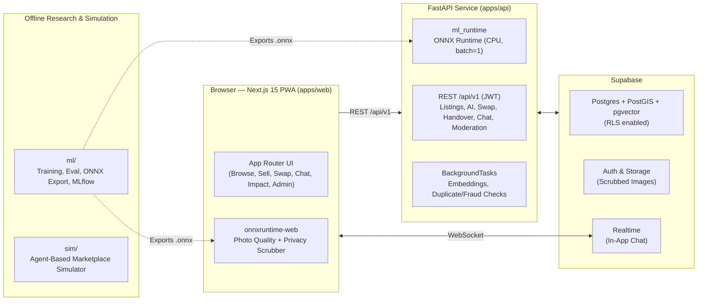

<div align="center">

# ♻️ LOOP — Hyperlocal AI Reuse Marketplace

**A human-in-the-loop, explainable, privacy-preserving AI marketplace for campus and neighborhood reuse.**

[](https://www.python.org/)
[](https://fastapi.tiangolo.com/)
[](https://nextjs.org/)
[](https://onnxruntime.ai/)
[](https://supabase.com/)
[](./LICENSE)

[Architecture](#-system-architecture) · [Features](#-core-features) · [ML & ONNX](#-ai--ml-pipeline) · [Quickstart](#-quickstart-local-dev) · [Docs](#-documentation)

</div>

---

**LOOP** enables campus, hostel, and housing-society communities to **sell, donate, and swap** pre-owned goods across **Electronics**, **Furniture**, **Books**, and **Hobbies & Recreation**. Built as both a working full-stack PWA and an engineering research project, LOOP pairs on-device privacy protection with lightweight, explainable CPU/Web AI models—without relying on paid external LLM/vision APIs.

---

## 🛡️ Design Principles

1. **Human-in-the-Loop by Default:** Every AI suggestion is editable, paired with a plain-language explanation and confidence score, and falls back to user confirmation below threshold (`ml/configs/thresholds.yaml`). AI outputs are never auto-published.
2. **Privacy-First Photos:** Faces, ID cards, number plates, phone numbers, and addresses are detected and scrubbed **on-device in the browser before upload**, with server-side re-verification (`POST /api/v1/scrub-verify` / `apps/api/app/routers/scrub_verify.py`).
3. **Coarse Location & Minimal PII:** Listings expose coarse area / geohash precision only—no public phone numbers or exact street addresses; all communication happens via in-app chat.
4. **Honest Evaluation & Attribution:** Rule-based components (swap matching, trust score, CO₂/waste impact, price-drop heuristics) are explicitly labeled as algorithmic, and all synthetic evaluation artifacts are tagged `synthetic`.
5. **Permissive-Only Stack:** All dependencies, weights, and datasets use permissive licenses (MIT / BSD / Apache-2.0 / ISC / CC0 / CC-BY) cataloged in [`THIRD_PARTY_LICENSES.md`](./THIRD_PARTY_LICENSES.md).

---

## ✨ Core Features

- **📸 Snap-to-List AI Autofill (`/sell`):**
  - On-device photo quality check (blur, lighting, clutter) and privacy scrubber before upload.
  - Server-side analysis returns category, subtype, brand/model, ordinal condition grade (with Grad-CAM saliency), conformal price range (with plain-language SHAP reasons), and draft title/description.
  - User edits feed an offline **Active Learning** loop (`corrections` table) to improve future model versions.
- **🔎 Multilingual Semantic Search (`/browse`):**
  - Supports natural-language queries in English and Hinglish via `pgvector` approximate nearest neighbors combined with SQL & PostGIS distance filters, benchmarked against a PostgreSQL full-text search baseline.
- **🔄 2- & 3-Way Swap Cycle Engine (`/swap`):**
  - Builds a directed "haves → wants" graph across users and solves for disjoint 2-way and 3-way trade cycles, generating multi-party swap proposals.
- **🤝 QR / OTP Verified Handover & Impact Tracking (`/chat`, `/impact`):**
  - Realtime in-app chat powered by Supabase Realtime, short-lived QR/OTP handover confirmation, mutual reviews, trust score updates, and estimated landfill/CO₂ savings.
- **🛡️ Fraud & Moderation Guardrails (`/admin`):**
  - Automated duplicate/scam flagging, community verification, Row-Level Security (RLS) isolation, and an admin moderation console.
- **🧪 Interactive Standalone Prototype (`prototype/`):**
  - Zero-backend HTML/CSS/JS prototype (`prototype/index.html`) for rapid UX walkthroughs and demos.

---

## 🏗️ System Architecture



---

## 🧠 AI & ML Pipeline

All ML models are trained offline in PyTorch / LightGBM, exported to **ONNX (Opset 17)** with verified numerical parity (`max_abs_diff < 1e-3`, tracked in [`ml/exports/onnx_manifest.json`](./ml/exports/onnx_manifest.json)), and documented with dedicated model cards:

| Model | Purpose | Placement | Architecture / Method | Model Card |
| :--- | :--- | :--- | :--- | :--- |
| **Photo Quality** | Blur / dark / clutter gate | Browser (`onnxruntime-web`) | `MobileNetV3-Small-QualityHead` | — |
| **Privacy Scrubber** | Face, ID, plate, PII detection | Browser + Server verify | `YuNet-YOLOX-Nano-PermissiveHead` | [`privacy_scrubber.md`](./ml/model_cards/privacy_scrubber.md) |
| **Product Recognition** | Category & subtype prediction | Server (`onnxruntime`) | `CLIP-ViT-B32-LinearProbe` | [`product_recognition.md`](./ml/model_cards/product_recognition.md) |
| **Condition Grader** | Ordinal condition + saliency | Server (`onnxruntime`) | `CORAL-Ordinal-CumulativeLink` | [`condition_grader.md`](./ml/model_cards/condition_grader.md) |
| **Price Estimator** | Split-conformal 80% price band | Server (`onnxruntime`) | `LightGBM-Conformal-Quantile` | [`price_estimator.md`](./ml/model_cards/price_estimator.md) |
| **Semantic Search** | English & Hinglish retrieval | Server + `pgvector` | Multilingual embeddings + ANN | [`semantic_search.md`](./ml/model_cards/semantic_search.md) |
| **Fraud & Scam** | Suspicious listing detection | Server (`BackgroundTasks`) | Feature & anomaly scoring | [`fraud_scam_detector.md`](./ml/model_cards/fraud_scam_detector.md) |

### Offline Simulator & Reproducible Figures

- **Marketplace Simulator (`sim/simulator.py`):** Seed-deterministic agent-based simulator evaluating 2-/3-way swap scaling (100 → 10k users), trust AUC, fraud PR curves, and price-drop time-to-sell.
- **Paper & Evaluation Reports (`ml/reports/`):** Reproducible figure manifest in [`ml/reports/figure_manifest.json`](./ml/reports/figure_manifest.json) with synthetic benchmark curves for active learning, simulator scaling, and user-study statistical pipelines.

---

## 🛠️ Tech Stack

| Layer | Technology |
| :--- | :--- |
| **Frontend** | Next.js 15 (App Router), React 19, TypeScript (strict), Tailwind CSS v4, Lucide Icons, PWA |
| **Backend** | FastAPI, Python 3.11, Pydantic v2, SQLAlchemy 2 (async), Alembic |
| **Database & Realtime** | Supabase (PostgreSQL + PostGIS + `pgvector`), Supabase Auth, Storage, Realtime |
| **ML & Inference** | PyTorch, LightGBM, scikit-learn, `onnxruntime` (CPU), `onnxruntime-web`, MLflow (local) |
| **Testing & Quality** | `pytest`, Playwright (E2E), `ruff`, `black`, `mypy` (strict), ESLint, Prettier, Locust (load) |
| **CI / Deployment** | GitHub Actions, Docker Compose, Render (`render.yaml`), Vercel (`apps/web/vercel.json`) |

---

## 📁 Repository Structure

```text
loop/
├── apps/
│   ├── api/                 # FastAPI backend, Alembic migrations, ml_runtime, pytest suite
│   └── web/                 # Next.js 15 PWA frontend, components, Playwright E2E tests
├── ml/
│   ├── configs/             # Training, confidence thresholds, and Label Studio configs
│   ├── exports/             # Exported ONNX models & parity manifest (onnx_manifest.json)
│   ├── model_cards/         # Model cards for every shipped model
│   ├── reports/             # Evaluation reports, figure_manifest.json, and SVG plots
│   └── src/                 # Training, active learning, ONNX export, and eval scripts
├── sim/                     # Agent-based marketplace simulator & YAML configs
├── prototype/               # Standalone HTML/CSS/JS interactive UX prototype
├── infra/                   # Supabase SQL setup & Locust load-testing scripts
├── scripts/                 # Seeding, copyright header checks, license/security audits
├── docs/                    # PRD, Architecture, API Spec, ML Spec, Paper Plan, Runbooks
├── docker-compose.yml       # Optional containerized local dev stack
└── render.yaml              # Render free-tier API deployment blueprint
```

---

## 🚀 Quickstart (Local Dev)

### Prerequisites: Hosted Supabase Dev Project

Local development uses a free-tier hosted Supabase project populated strictly with synthetic/seed data (no local Docker or WSL installation required):

1. Create a free project at [supabase.com](https://supabase.com) (e.g., `loop-dev`).
2. Copy your `Project URL`, `anon` key, and `service_role` key from **Project Settings → API**.
3. Copy your PostgreSQL connection string from **Project Settings → Database**.
4. Ensure no production or personal data is stored in the development project.

### Setup & Run

```bash
# 1. Clone repository and enter directory
git clone https://github.com/loop-marketplace/loop.git && cd loop

# 2. Copy environment template and fill in hosted Supabase credentials
cp .env.example .env

# 3. Create and activate Python 3.11 virtual environment for API
python3.11 -m venv apps/api/.venv && source apps/api/.venv/bin/activate  # Windows: apps\api\.venv\Scripts\activate

# 4. Install backend dependencies
pip install -r apps/api/requirements.txt

# 5. Run database migrations against your hosted dev project
cd apps/api && alembic upgrade head && cd ../..

# 6. Install frontend dependencies
npm --prefix apps/web ci

# 7. Start FastAPI backend (runs at http://localhost:8000, docs at /docs)
cd apps/api && uvicorn app.main:app --reload --port 8000

# 8. In a separate terminal, start Next.js web frontend (runs at http://localhost:3000)
npm --prefix apps/web run dev
```

> **Optional Docker Workflow:** Docker and WSL are optional for local development. Container builds and healthchecks are automatically verified in GitHub Actions (`docker-compose-test`). If you prefer containers locally, run `docker compose up`.

---

## ✅ Testing & Verification

```bash
# Backend unit & acceptance tests
cd apps/api && pytest -v

# Backend lint, formatting & strict type-checking
ruff check apps/api
black --check apps/api
cd apps/api && mypy app

# Frontend type-check, lint & production build
npm --prefix apps/web run type-check
npm --prefix apps/web run lint
npm --prefix apps/web run build

# Copyright header & security/license audits
python scripts/check_copyright_headers.py
```

---

## 📚 Documentation

| Document | Description |
| :--- | :--- |
| [`docs/PRD.md`](./docs/PRD.md) | Product requirements, priorities, and acceptance criteria |
| [`docs/ARCHITECTURE.md`](./docs/ARCHITECTURE.md) | System components, data flows, and model placement |
| [`docs/DATA_MODEL_AND_API.md`](./docs/DATA_MODEL_AND_API.md) | Database schema, RLS policies, and REST `/api/v1` contracts |
| [`docs/ML_SPEC.md`](./docs/ML_SPEC.md) | Models, datasets, metrics, scrubber, active learning, and simulator spec |
| [`docs/ROADMAP.md`](./docs/ROADMAP.md) | Phased implementation roadmap and acceptance checks |
| [`docs/PAPER_PLAN.md`](./docs/PAPER_PLAN.md) | Research paper structure, figures, and reproducibility |
| [`docs/DEMO_SCRIPT.md`](./docs/DEMO_SCRIPT.md) | End-to-end demo walkthrough |
| [`docs/IP_AND_COMPLIANCE.md`](./docs/IP_AND_COMPLIANCE.md) | Ownership, ethics, licensing rules, and copyright filing |

---

## 📄 License & Third-Party Attributions

All proprietary code is **Copyright (c) 2026 Emmanuel George P and Sameer Makani. All rights reserved.**  
Third-party permissive licenses and attributions are cataloged in [`THIRD_PARTY_LICENSES.md`](./THIRD_PARTY_LICENSES.md).  
Security exceptions are documented in [`docs/SECURITY_EXCEPTIONS.md`](./docs/SECURITY_EXCEPTIONS.md).
